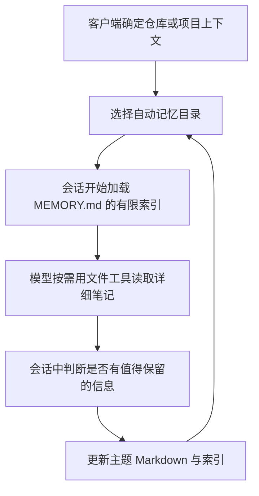

# 调研：Claude Code 如何自动识别项目并维护记忆

> 调研日期：2026-10-15。依据 Anthropic 官方文档与官方 changelog；未读取用户的 `~/.claude` 记忆或会话内容，未反编译客户端。本机 CLI 经只读核验为 `2.1.216`。最新文档可能包含更新版本功能，下文单独标明。

## 结论

**Claude Code 的原生自动记忆不要求执行任务的 Agent 传 `project_id`。** 客户端根据仓库上下文选择 `~/.claude/projects/<project>/memory/`，自动加载该目录的索引；模型在会话中读写 Markdown 记忆。这里“不需要传 ID”是由宿主承担目录路由，不是模型无需上下文就能猜到所属项目。[默认存储][storage]、[读写机制][how]

**默认按仓库分目录，同一仓库的 worktree 和子目录共享。** 这比本次研究版本的 Codex 共享摘要空间更明确地区分默认加载范围；但仍是文件选择机制，不是访问控制或保证模型永远无法读取其他项目文件。[Claude 存储说明][storage]、[Codex 对照研究](./codex-memory-research.md#3-项目范围共享空间--来源边界提示)

## 1. 两类记忆分别做什么

| 机制 | 谁维护 | 范围与用途 |
| --- | --- | --- |
| `CLAUDE.md` / `.claude/rules/` | 用户或团队为主 | 持久指令；支持个人、项目、组织层次 |
| Auto memory | Claude 在工作中维护 | 默认仓库内的经验、反馈和上下文笔记 |

两者都作为模型上下文，而不是强制执行配置。跨项目个人指令可放 `~/.claude/CLAUDE.md` 或 `~/.claude/rules/`；自动记忆中的 `user` 类型并不因此自动变成全局命名空间。[机制对照][vs]、[个人规则][user-rules]、[记忆类型][auto]

`CLAUDE.md` 沿工作目录的祖先路径加载，子目录指令按需加载。因此“项目自动记忆同目录”不等于“所有子目录加载完全相同指令”。[指令加载规则][load]

## 2. 自动项目路由的边界

| 场景 | 官方文档明确的行为 |
| --- | --- |
| 不同仓库 | 默认各有自己的自动记忆目录 |
| 同仓库子目录 | 使用同一自动记忆目录 |
| 同仓库 Git worktree | 使用同一自动记忆目录 |
| 非 Git 目录 | 改用 project root |
| 跨机器或云环境 | 自动记忆文件不自动同步 |

上述均来自官方存储说明。它没有公开路径编码、哈希、符号链接归一化、非 Git project root 的完整判定算法；不能据此声称按 Git remote URL 合并独立 clone，或将同名仓库认作同一项目。[storage]

默认目录也可以改写：

- `autoMemoryDirectory` 指定绝对路径或 `~/` 路径，可从多个 settings scope 配置，受项目配置的 trust 与外部目录读取策略约束。[storage]
- `CLAUDE_CONFIG_DIR` 配合 `CLAUDE_CODE_PROJECT_DIR_NAME` 可固定 `projects/` 下的目录名，使不同仓库共用目录；后者要求 `v2.1.234+`，本机 `2.1.216` 不包含这项功能。[环境变量][project-name]

这说明默认项目分桶是可配置行为，不能描述为不可绕过的项目隔离。即使记忆类型是 `feedback` 或 `user`，它仍先落在选定目录中；要跨仓库共享应选择合适的指令或目录配置。[auto]、[storage]

## 3. 生成和读取流程

当前官方说明将记忆区分为 `user`、`feedback`、`project`、`reference`；由 Claude 判断是否值得长期保存，不保证每次会话都写入。它不是官方承诺的后台全局整理管线。[auto]

启动时只加载 `MEMORY.md` 的前 **200 行或 25KB，先达到者为准**；详细文件按需由普通文件工具打开。官方 changelog 同样记录了索引大小限制以及临近上限时的整理提醒。[how]、[Changelog][changelog]

索引超限时写入仍可成功，但客户端会向 Claude 返回需要压缩索引的错误；超出部分下一次启动不会加载。记忆文件可由用户编辑删除，普通会话历史清理不删除记忆目录。[how]、[storage]

因此公开证据支持“项目目录 + 简短索引 + 按需文件读取”的机制；没有证据证明它依赖向量数据库、embedding 排序、固定的后台提取模型或与 Mem0 等价的事实合并算法。官方还明确指出其系统提示未公开。[how]、[设置文档][settings]

## 4. 主会话与 subagent 不是同一个记忆空间

普通 subagent 不自动加载主会话的 auto memory；fork 继承父会话上下文，是例外。subagent 可用 frontmatter 的 `memory` 字段配置自己的持久目录：[主会话规则][how]、[Subagent memory][subagents]

| `memory` 值 | 目录 | 用途 |
| --- | --- | --- |
| `user` | `~/.claude/agent-memory/<agent-name>/` | 同一命名 agent 跨项目复用 |
| `project` | `.claude/agent-memory/<agent-name>/` | 项目内共享，可提交版本控制 |
| `local` | `.claude/agent-memory-local/<agent-name>/` | 项目内个人笔记 |

客户端给启用记忆的 subagent 加入目录说明、有限索引和文件工具；其作用域是配置决定的，无需每次工具调用提交 `project_id`。主开关关闭 auto memory 时，subagent 的 `memory` 字段也不生效。[subagents]

## 5. 对 Hippo 更直接的证据：MCP 的项目上下文

Claude Code 原生记忆与外部 MCP 服务不是同一实现，但官方 MCP 文档提供了两个宿主自动输出上下文的通道：[MCP stdio 与 roots][mcp]

1. **本地 stdio 服务进程环境**：客户端自动设置 `CLAUDE_PROJECT_DIR`，值为稳定 project root；增加额外工作目录不会改变它。服务可直接读取环境变量，不必要求模型重复填写项目 ID。
2. **MCP `roots/list`**：客户端返回会话启动目录与已授权的附加目录，集合变化时发送 `notifications/roots/list_changed`。它描述可用目录集合，不保证只有一个仓库，也不应直接视作当前唯一项目。

上述环境变量是在服务子进程中设置，不能把它与 Claude 自身启动环境中的 `${VAR}` 展开混为一谈。对于 HTTP 等远端服务，也不能假设它们会继承本地子进程环境。[mcp]

由此得到的 Hippo 设计推论是：可以在服务端接收并规范化宿主提供的路径，再映射到 Hippo 的项目标识；不需要让 Agent 为每次调用主动选择 ID。若有多个候选仓库、来源缺失或远端路径无法可靠映射，仍需明确消除歧义。此处是设计建议，**尚未实现或实测新的 Hippo 适配**。

## 6. 版本核对与证据限制

官方 changelog 给出这些引入版本，可与本机 `2.1.216` 对照：[changelog]

| 功能 | 版本 | 本机版本是否晚于引入版本 |
| --- | --- | --- |
| 自动保存有用上下文到 auto memory | `2.1.59` | 是 |
| 同仓库 worktree 共享自动记忆 | `2.1.63` | 是 |
| `autoMemoryDirectory` | `2.1.74` | 是 |
| `MEMORY.md` 同时受 25KB 限制 | `2.1.83` | 是 |
| MCP stdio 子进程 `CLAUDE_PROJECT_DIR` | `2.1.139` | 是 |
| `CLAUDE_CODE_PROJECT_DIR_NAME` | `2.1.234` | 否 |
| 原生发现 `AGENTS.md` | `2.1.277` | 否 |

`AGENTS.md` 当前支持的默认发现与回退规则见官方说明；不能把最新文档中的原生支持套用到本机版本。[AGENTS.md][agents-md]

本次只核验版本、文档和发布记录，没有启动真实 Claude 会话验证记忆保存，也没有检查真实 MCP 初始化或调用报文。引入版本小于安装版本不等于该连接已通过实测；具体运行还取决于开关、环境与客户端状态。闭源内部实现只在官方描述范围内下结论。

## 参考来源

[vs]: https://code.claude.com/docs/en/memory#claude-md-vs-auto-memory
[storage]: https://code.claude.com/docs/en/memory#storage-location
[how]: https://code.claude.com/docs/en/memory#how-it-works
[auto]: https://code.claude.com/docs/en/memory#auto-memory
[load]: https://code.claude.com/docs/en/memory#how-claude-md-files-load
[user-rules]: https://code.claude.com/docs/en/memory#user-level-rules
[agents-md]: https://code.claude.com/docs/en/memory#agents-md
[subagents]: https://code.claude.com/docs/en/sub-agents#enable-persistent-memory
[settings]: https://code.claude.com/docs/en/settings#change-a-setting
[project-name]: https://code.claude.com/docs/en/env-vars
[mcp]: https://code.claude.com/docs/en/mcp#option-3-add-a-local-stdio-server
[changelog]: https://github.com/anthropics/claude-code/blob/main/CHANGELOG.md
