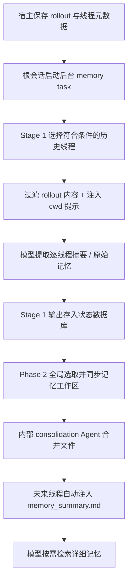

# 调研：Codex 内置 Memory 如何识别项目上下文

> 调研日期：2026-10-15。本文更新 2026-09-06 的旧笔记，主要依据 OpenAI 官方公开源码，所有源码链接固定到提交。未读取用户 `~/.codex/memories`、`memories_v2` 或历史聊天内容。

## 结论

**Codex 内置 Memory 不要求执行任务的 Agent 主动填写 `project_id`。** 宿主已经持有线程 ID、会话工作目录和 rollout 路径；后台直接用这些元数据提取记忆，前台自动注入已有记忆摘要。详细检索仍由模型按需进行。[会话元数据写入][recorder]、[提取调用][phase1-job]、[摘要注入][read-builder]

**这不等于严格的项目隔离。** 在研究版本中，V1/V2 都是同一 `CODEX_HOME` 下按记忆版本共享的记忆空间；后台选取线程时明确不设置 `cwd` 或 `project_id` 过滤，注入摘要时也不按当前项目筛选。`cwd` 主要作为来源信息、适用边界和模型检索线索。[候选过滤][claim-filters]、[全局合并选择][phase2-selection]、[版本目录][version]、[注入参数][read-builder]

**独立 MCP 不能直接复用宿主的内部状态，但当前 Codex 公开源码提供了一条比 roots 更具体的适配线索。** 普通工具调用自动带 `_meta.threadId` / `_meta.sessionId`；如果 server 在初始化结果中声明 `capabilities.experimental["codex/sandbox-state-meta"]`，Codex 会在后续工具调用的 `_meta` 中附上含 `sandboxCwd` 的沙箱上下文。它是 Codex 专有扩展，仍需针对真实连接实测；不能据此断言现有 Hippo 已收到该字段。[ID 元数据][mcp-ids]、[扩展协商][mcp-capability]、[cwd 附加逻辑][mcp-sandbox]

## 研究版本与边界

| 项目 | 本次核验 |
| --- | --- |
| 当前桌面 bundled CLI | `/Applications/ChatGPT.app/Contents/Resources/codex-cli/CodexCLI.app/Contents/MacOS/codex`，版本 `0.162.0-alpha.17.2` |
| 主要源码 | 官方 tag [`rust-v0.162.0-alpha.17.2`](https://github.com/openai/codex/tree/rust-v0.162.0-alpha.17.2)，annotated tag 对应 commit [`740e5af33c71225640e0c1c1555c514c2c93ab74`](https://github.com/openai/codex/commit/740e5af33c71225640e0c1c1555c514c2c93ab74) |
| 本机另一个 CLI | `/opt/homebrew/bin/codex`，版本 `0.155.1` |
| 对照源码 | 官方 tag [`rust-v0.155.1`](https://github.com/openai/codex/tree/rust-v0.155.1)，commit [`be2951ea34f0d295ed0becf97079f92fa5f6950e`](https://github.com/openai/codex/commit/be2951ea34f0d295ed0becf97079f92fa5f6950e) |

上述版本号来自本机只读核验，tag 到 commit 的映射来自 GitHub 官方 API。两版的核心生成链路、V1/V2 模板、记忆目录选择、摘要注入逻辑一致。本文其余源码引用均以桌面对应的 `740e5af...` 为准。

这证明公开发行代码中存在这些实现；不证明当前桌面运行时启用了 Memory、选择了哪个 MemoryVersion、开启了 dual-write 或 dedicated tools，也不证明桌面所有专有宿主行为都由该仓库覆盖。本文没有检查私人运行配置。

官方产品文档可用于理解用户侧行为：[Memories](https://learn.chatgpt.com/docs/customization/memories?surface=app)、[Projects](https://learn.chatgpt.com/docs/projects)、[Configuration reference](https://learn.chatgpt.com/docs/config-file/config-reference)。实现细节以本文固定版本的源码证据为准。

## 1. 宿主如何知道 cwd 和线程 ID

创建 rollout 时，`RolloutRecorder` 直接从运行配置取得 `cwd`，把 `conversation_id` 写入 `SessionMeta.id`，同时保存 `session_id`、`cwd`、runtime workspace roots、CLI 版本等字段。这些是宿主生成的元数据，不需要模型从自然语言猜测，也不需要调用记忆工具时重新填写。[recorder.rs][recorder]

线程状态数据库同样持有 `cwd`，并且**确实存在** `project_id: Option<String>`：源码将后者注明为由 app-server 拥有的 canonical project assignment。因此准确表述是“内置记忆这条链路不以 `project_id` 作必填输入或隔离条件”，不能说“Codex 整个系统没有 project_id”。[ThreadMetadata][thread-metadata]

rollout 元数据会被应用到线程状态；Stage 1 的 job claim 返回完整 `ThreadMetadata`。随后提取代码直接读取 `claimed_thread.rollout_path` / `cwd` / `git_branch`，输出结果又由程序绑定回 `claimed_thread.id`。模型负责总结内容，线程归属由宿主保留。[元数据提取][state-extract]、[Stage1JobClaim][stage1-model]、[提取与写回][phase1-job]

这里也应区分线程 ID 与 rollout 文件名：发生 revert 后，物理 rollout ID 可能变化，稳定线程 ID 仍是 `SessionMeta.id`；不能把扫描到的文件名无条件当作当前线程身份。[HistoryPosition 注释][rollout-identity]

## 2. 原始 rollout 到记忆文件的链路



### 后台任务的触发

入口是 `start_memories_startup_task`，在符合条件的**根会话启动时**异步运行，先 Stage 1 后 Phase 2。它跳过 ephemeral 会话、未启用记忆 feature 的会话和非根 Agent；还要求可用的状态数据库，并检查额度门禁。它不是“每次对话结束立即保存一条记忆”。[start.rs][startup]

Stage 1 从状态数据库领取符合条件的历史线程任务，按来源、时间窗、空闲时长、memory mode、当前是否被领取等条件限制工作量；当前刚启动的线程被排除。这里的当前 thread ID 主要用于领取任务和协调，并不意味着“只处理同一线程或同一项目的记忆”。[phase1.rs][phase1-claim]、[数据库候选条件][claim-filters]

### Stage 1：逐线程提取

提取过程读 rollout 文件、过滤成适合记忆的模型输入，再构造提取请求。V1 输入显式包含 `rollout_path` / `rollout_cwd`，V2 包含 `rollout_primary_cwd_hint` / branch hint。V1 的过滤会排除 `SessionMeta` / `TurnContext` 等原始记录，因此不能说“模型直接拿到所有原始元数据”；关键目录是由宿主单独写入提取提示。[实际提取调用][phase1-sample]、[V1 输入模板][stage1-input]、[V2 输入模板][stage1-input-v2]、[V1 过滤][phase1-filter]

两个版本的提取契约不同：[phase1_output.rs][stage1-output]

| 版本 | 模型输出 | 后续物理文件 |
| --- | --- | --- |
| V1（枚举默认值） | `raw_memory`、`rollout_summary`、可选 `rollout_slug` | `raw_memories.md`、逐线程 summaries，再合并成 `MEMORY.md` / `memory_summary.md` 等 |
| V2 | `rollout_summary`、`rollout_slug`，不解析 raw memory | 逐线程 summaries，再合并成 `memory_summary.md`；没有 V1 的 raw 文件同步步骤 |

输出经过秘密脱敏，V2 summary 额外限制为 9,000 bytes；成功结果由 `mark_stage1_job_succeeded` 写入数据库。线程 ID、更新时间由程序绑定，模型无需提供 `project_id`。[输出解析][stage1-output]、[写回][phase1-writeback]

### Phase 2：全局 consolidation

Phase 2 对当前版本的共享工作区申请全局锁，按使用次数、最近使用/来源时间、保留窗口及数量限制选取 Stage 1 输出，未按项目过滤。同步 summaries；V1 额外重建 `raw_memories.md`。文件头由程序附上 `thread_id` / `cwd` / `rollout_path`，便于后续追溯。[全局查询][phase2-selection]、[Phase 2 编排][phase2-run]、[版本同步差异][phase2-sync]、[文件元数据][storage]

工作区以 Git baseline 比较变更，产生 `phase2_workspace_diff.md`，有变更或产物无效时启动内部 consolidation Agent。该 Agent 的 cwd 被切到记忆目录；关闭记忆递归生成/使用、MCP、Apps、Plugins 与递归委派。对于 managed 权限，配置只允许记忆目录写入、禁止网络；若父权限明确 Disabled/External，则保留父权限选择，不能把“永远强制无网络沙箱”作为无条件结论。[phase2.rs][phase2-run]、[Agent 配置][phase2-agent]

V1 consolidation 模板要求生成可检索手册 `MEMORY.md` 和摘要 `memory_summary.md`，并保留 cwd 适用范围。V2 consolidation 模板只要求汇总 `memory_summary.md`，按 project scope 组织来源指针、保留语境；同时明确不打开原始 rollout transcripts。[V1 产物与边界][consolidation-v1]、[V2 契约][consolidation-v2]

## 3. 项目范围：共享空间 + 来源边界提示

四处源码共同说明当前实现不是按项目自动硬分库：

1. **目录**：`MemoryVersion::V1 -> "memories"`、`V2 -> "memories_v2"`，实际路径是 `codex_home.join(version.directory_name())`，没有拼入 cwd 或 project ID。[目录枚举][version]、[启动目录][startup]
2. **Stage 1 候选**：`ThreadFilterOptions` 明写 `cwd_filters: None`、`project_id: None`。[候选过滤][claim-filters]
3. **Phase 2 选取**：查询全局 `stage1_outputs`，输入参数只有数量和保留窗口；逐线程开启状态仍会被检查，没有当前项目筛选参数。[全局查询][phase2-selection]
4. **前台注入**：`build_memory_tool_developer_instructions(codex_home, version)` 读取整个对应目录的摘要，没有当前 cwd 或 project ID 参数。[摘要构造][read-builder]

所以这里的“全局”应理解为**同一 `CODEX_HOME` / 同一 MemoryVersion 命名空间**，不是证明所有设备、所有账户或所有 Codex homes 都共享同一个云记忆库。V1/V2 分目录是版本隔离，不是项目隔离。

`cwd` 的作用很具体：Stage 1 输入提供 primary hint；磁盘产物记录来源路径；V1 `MEMORY.md` 必须写 `applies_to: cwd=...; reuse_rule=...`，默认分开不同 cwd 下的相似任务；摘要索引按 cwd/project scope 组织。V2 同样要求保留 project scope。这些属于**模型要遵守的适用性与检索提示**，不能替代查询时不可绕过的租户/项目过滤。[cwd 元数据][storage]、[V1 applies_to][consolidation-v1]、[V1 索引规则][consolidation-index]、[V2 scope][consolidation-v2]

## 4. 读取时自动注入什么，Agent 又做什么

记忆 extension 在 feature 和 `use_memories` 都启用时贡献线程上下文。它读取对应全局目录的 `memory_summary.md`，最多注入 2,500 tokens，将摘要与读取说明作为 developer policy 放入模型上下文。读文件失败、摘要为空或功能关闭时不注入。这里没有调用 Hippo MCP，也没有让模型传 `project_id`。[extension.rs][read-extension]、[摘要读取与截断][read-builder]、[token 常量][read-limit]

自动注入的是**摘要及读取说明**，不是把所有 `MEMORY.md`、rollout summaries 和原始聊天全文全部塞入每个新会话：

- V1 读取模板让模型先看已经注入的摘要，再按关键词搜索 `MEMORY.md`，必要时展开少量 summaries/skills，最后才追溯原始 rollout。它是提示引导的按需检索。[V1 read_path.md][read-v1]
- V2 读取模板允许直接使用摘要中已有的偏好、决定和来源指针；只有补充证据可能改变答案时才读取对应 summary，缺少必要路径时选择性搜索。[V2 read_path_v2.md][read-v2]
- 若 `dedicated_tools` 开启，extension 会把本地记忆 backend 绑定到同一版本的记忆目录，再注册 `memories` namespace 工具；否则仍可由通用文件工具按提示读取。内置 `search` 的参数是 queries、匹配模式、可选 path、分页/结果限制等，没有 `project_id`；本地实现是目录内子串匹配，非项目 ID 过滤。[工具注册][dedicated-tools]、[search schema][search-args]、[本地 search][local-search]

“Codex 不用传 project_id”因此包含两个原因：生成/注入由宿主直接接线，详细读取面向已绑定的共享记忆目录。这一实现也接受跨项目共享偏好和历史索引，并未承诺只返回当前项目资料。

## 5. 独立 MCP 能自动获得哪些上下文

### 标准 roots 与内置状态不能混为一谈

Codex 的内部记忆任务能直接访问 Config、线程存储和 rollout；独立 HTTP MCP 服务收到的是协议消息，不会因为客户端内部知道 cwd，就自动获得整个宿主状态数据库。

本版默认 MCP 初始化构造 `ClientCapabilities::default()`，增加 elicitation 与协商 extensions，没有设置 roots；所检 `LoggingClientHandler` 也没有实现 `list_roots`。因此 Hippo 发现 roots 不可用，与“Codex 内部有 cwd”并不矛盾。[初始化源码][mcp-initialize]、[client handler][mcp-handler]

### tools/call 已有自动 ID 元数据

普通 MCP 工具调用发送前，程序会追加 `threadId` 和 `sessionId`，有调用来源时还会追加 window/item ID。它们在请求的 `_meta` 中，不是模型填入工具 arguments 的字段。[发送调用链][mcp-call-chain]、[键名][mcp-id-keys]、[ID 赋值][mcp-ids]

线程 ID 可以作为会话关联线索，但**单独的 threadId 不是 project ID，也不直接告诉远端 cwd**。如果没有另一条可信映射，不能凭它自动推导项目。

### Codex 专有 sandbox-state-meta 可携带 cwd

源码支持 server 显式声明：

```json
{
  "capabilities": {
    "experimental": {
      "codex/sandbox-state-meta": {}
    }
  }
}
```

Codex 从初始化结果的 experimental capabilities 判断这个 key 是否存在。支持时，在 `tools/call._meta["codex/sandbox-state-meta"]` 加入 `SandboxState`。该结构使用 camelCase JSON，包含 `sandboxCwd`、permission profile 等；`sandboxCwd` 是 `PathUri`，不能当任意主机的裸本地路径处理。[capability 定义][mcp-cap-key]、[协商检查][mcp-capability]、[结构体][sandbox-state]、[附加逻辑][mcp-sandbox]

cwd 的取值优先使用 server 所属 environment 的 captured cwd，回退到当前匹配的 turn environment；默认 environment 还可回退到当前 turn cwd。也就是说，这是**与调用环境绑定的宿主元数据**，比让模型填写项目名更可靠，但语义是沙箱/执行环境 cwd，仍不是规范化的 Git 项目标识。[cwd 选择][mcp-sandbox-cwd]

这给 Hippo 一个值得验证的免手填方案：标准 roots 之外，增加 Codex 专有请求元数据适配器，从 `sandboxCwd` 解析规范化项目线索，再由服务端执行现有项目解析与安全门禁。此处是根据源码提出的工程推论，**本次尚未修改 Hippo、声明 capability 或抓取真实请求，不能称为已经验证兼容**。

### 对 Hippo 的具体启示

| 场景 | 是否可免模型填写项目 | 仍需解决的问题 |
| --- | --- | --- |
| Codex 内置记忆 | 可以，宿主原生持有上下文 | 本身采用共享空间与提示边界，不能当硬项目隔离范例 |
| 客户端提供标准 roots | 可以从协议读取 | 多 roots、worktree、远端路径与项目归一化 |
| 当前公开 Codex 的专有 sandbox metadata | 源码显示有可行路径，需实测 | 初始化 capability、请求 `_meta` 的传递与读取、PathUri 解析、版本兼容 |
| 独立 HTTP MCP 只收到普通 arguments / IDs | 无法凭空恢复 cwd | 需要显式参数、可信宿主适配或部署端绑定之一 |
| 本地 stdio MCP | 可能从进程启动 cwd 获得线索 | 启动 cwd 不一定等于每次调用的当前项目，多会话/环境切换需验证 |

stdio 的特殊性在于 Codex 启动 MCP 子进程时确实有 cwd/launcher 上下文；HTTP transport 则只配置 URL、headers 等。这不能推广成“所有 MCP server 都能读取客户端 cwd”。[transport 构造][mcp-transport]

应借鉴 Codex 的是“由宿主提供环境上下文，再由确定性代码绑定”，而不是取消 Hippo 的项目门禁。不要用全局最近打开项目、最后写入项目、任意最新 rollout 或另一个会话的 cwd 去补齐当前调用；这些猜测不能建立可靠归属。

## 6. 对旧笔记的修订

旧笔记把 MCP memory 与内置 memory 区分开，这个方向仍然成立：内置后台 pipeline 和摘要注入不等于自动执行 Hippo 的 `search_memories`。但“自动注入”应具体表述为摘要加指令，详细资料通常仍由模型按需读取；还应区分本版 V1/V2，不能一概描述为 `raw_memories.md -> MEMORY.md`。[注入实现][read-extension]、[V1/V2 同步][phase2-sync]

旧笔记未回答项目上下文来源，现补充为：**宿主保存 cwd/thread 元数据；内置 Memory 无需 Agent 主动传 project_id，但没有据此建立严格项目分库；外部 MCP 的自动路由需要协议上下文，当前 Codex 专有 sandbox metadata 是可核验的新线索。**

[recorder]: https://github.com/openai/codex/blob/740e5af33c71225640e0c1c1555c514c2c93ab74/codex-rs/rollout/src/recorder.rs#L906-L981
[thread-metadata]: https://github.com/openai/codex/blob/740e5af33c71225640e0c1c1555c514c2c93ab74/codex-rs/state/src/model/thread_metadata.rs#L160-L195
[state-extract]: https://github.com/openai/codex/blob/740e5af33c71225640e0c1c1555c514c2c93ab74/codex-rs/state/src/extract.rs#L82-L121
[stage1-model]: https://github.com/openai/codex/blob/740e5af33c71225640e0c1c1555c514c2c93ab74/codex-rs/state/src/model/memories.rs#L8-L51
[rollout-identity]: https://github.com/openai/codex/blob/740e5af33c71225640e0c1c1555c514c2c93ab74/codex-rs/protocol/src/protocol.rs#L3090-L3099
[startup]: https://github.com/openai/codex/blob/740e5af33c71225640e0c1c1555c514c2c93ab74/codex-rs/memories/write/src/start.rs#L20-L92
[phase1-claim]: https://github.com/openai/codex/blob/740e5af33c71225640e0c1c1555c514c2c93ab74/codex-rs/memories/write/src/phase1.rs#L120-L156
[claim-filters]: https://github.com/openai/codex/blob/740e5af33c71225640e0c1c1555c514c2c93ab74/codex-rs/state/src/runtime/memories.rs#L225-L257
[phase1-job]: https://github.com/openai/codex/blob/740e5af33c71225640e0c1c1555c514c2c93ab74/codex-rs/memories/write/src/phase1.rs#L197-L255
[phase1-sample]: https://github.com/openai/codex/blob/740e5af33c71225640e0c1c1555c514c2c93ab74/codex-rs/memories/write/src/phase1.rs#L258-L319
[stage1-input]: https://github.com/openai/codex/blob/740e5af33c71225640e0c1c1555c514c2c93ab74/codex-rs/memories/write/templates/memories/stage_one_input.md#L1-L11
[stage1-input-v2]: https://github.com/openai/codex/blob/740e5af33c71225640e0c1c1555c514c2c93ab74/codex-rs/memories/write/templates/memories/stage_one_input_v2.md#L1-L20
[phase1-filter]: https://github.com/openai/codex/blob/740e5af33c71225640e0c1c1555c514c2c93ab74/codex-rs/memories/write/src/phase1.rs#L396-L423
[stage1-output]: https://github.com/openai/codex/blob/740e5af33c71225640e0c1c1555c514c2c93ab74/codex-rs/memories/write/src/phase1_output.rs#L11-L80
[phase1-writeback]: https://github.com/openai/codex/blob/740e5af33c71225640e0c1c1555c514c2c93ab74/codex-rs/memories/write/src/phase1.rs#L363-L390
[phase2-selection]: https://github.com/openai/codex/blob/740e5af33c71225640e0c1c1555c514c2c93ab74/codex-rs/state/src/runtime/memories.rs#L440-L547
[phase2-run]: https://github.com/openai/codex/blob/740e5af33c71225640e0c1c1555c514c2c93ab74/codex-rs/memories/write/src/phase2.rs#L55-L175
[phase2-sync]: https://github.com/openai/codex/blob/740e5af33c71225640e0c1c1555c514c2c93ab74/codex-rs/memories/write/src/phase2.rs#L194-L208
[storage]: https://github.com/openai/codex/blob/740e5af33c71225640e0c1c1555c514c2c93ab74/codex-rs/memories/write/src/storage.rs#L49-L145
[phase2-agent]: https://github.com/openai/codex/blob/740e5af33c71225640e0c1c1555c514c2c93ab74/codex-rs/memories/write/src/phase2.rs#L294-L353
[version]: https://github.com/openai/codex/blob/740e5af33c71225640e0c1c1555c514c2c93ab74/codex-rs/protocol/src/memory_version.rs#L7-L22
[consolidation-v1]: https://github.com/openai/codex/blob/740e5af33c71225640e0c1c1555c514c2c93ab74/codex-rs/memories/write/templates/memories/consolidation.md#L175-L217
[consolidation-index]: https://github.com/openai/codex/blob/740e5af33c71225640e0c1c1555c514c2c93ab74/codex-rs/memories/write/templates/memories/consolidation.md#L579-L596
[consolidation-v2]: https://github.com/openai/codex/blob/740e5af33c71225640e0c1c1555c514c2c93ab74/codex-rs/memories/write/templates/memories/consolidation_v2.md#L1-L52
[read-extension]: https://github.com/openai/codex/blob/740e5af33c71225640e0c1c1555c514c2c93ab74/codex-rs/ext/memories/src/extension.rs#L38-L100
[read-builder]: https://github.com/openai/codex/blob/740e5af33c71225640e0c1c1555c514c2c93ab74/codex-rs/ext/memories/src/prompts.rs#L31-L63
[read-limit]: https://github.com/openai/codex/blob/740e5af33c71225640e0c1c1555c514c2c93ab74/codex-rs/ext/memories/src/lib.rs#L11-L22
[read-v1]: https://github.com/openai/codex/blob/740e5af33c71225640e0c1c1555c514c2c93ab74/codex-rs/ext/memories/templates/memories/read_path.md#L1-L49
[read-v2]: https://github.com/openai/codex/blob/740e5af33c71225640e0c1c1555c514c2c93ab74/codex-rs/ext/memories/templates/memories/read_path_v2.md#L1-L20
[dedicated-tools]: https://github.com/openai/codex/blob/740e5af33c71225640e0c1c1555c514c2c93ab74/codex-rs/ext/memories/src/extension.rs#L133-L158
[search-args]: https://github.com/openai/codex/blob/740e5af33c71225640e0c1c1555c514c2c93ab74/codex-rs/ext/memories/src/tools/search.rs#L28-L62
[local-search]: https://github.com/openai/codex/blob/740e5af33c71225640e0c1c1555c514c2c93ab74/codex-rs/ext/memories/src/local/search.rs#L17-L66
[mcp-initialize]: https://github.com/openai/codex/blob/740e5af33c71225640e0c1c1555c514c2c93ab74/codex-rs/codex-mcp/src/rmcp_client.rs#L1106-L1129
[mcp-handler]: https://github.com/openai/codex/blob/740e5af33c71225640e0c1c1555c514c2c93ab74/codex-rs/rmcp-client/src/logging_client_handler.rs#L26-L141
[mcp-call-chain]: https://github.com/openai/codex/blob/740e5af33c71225640e0c1c1555c514c2c93ab74/codex-rs/core/src/mcp_tool_call.rs#L521-L547
[mcp-id-keys]: https://github.com/openai/codex/blob/740e5af33c71225640e0c1c1555c514c2c93ab74/codex-rs/core/src/mcp_tool_call.rs#L1249-L1257
[mcp-ids]: https://github.com/openai/codex/blob/740e5af33c71225640e0c1c1555c514c2c93ab74/codex-rs/core/src/mcp_tool_call.rs#L1407-L1438
[mcp-cap-key]: https://github.com/openai/codex/blob/740e5af33c71225640e0c1c1555c514c2c93ab74/codex-rs/codex-mcp/src/rmcp_client.rs#L95-L97
[mcp-capability]: https://github.com/openai/codex/blob/740e5af33c71225640e0c1c1555c514c2c93ab74/codex-rs/codex-mcp/src/rmcp_client.rs#L991-L996
[sandbox-state]: https://github.com/openai/codex/blob/740e5af33c71225640e0c1c1555c514c2c93ab74/codex-rs/codex-mcp/src/runtime.rs#L785-L795
[mcp-sandbox]: https://github.com/openai/codex/blob/740e5af33c71225640e0c1c1555c514c2c93ab74/codex-rs/core/src/mcp_tool_call.rs#L853-L909
[mcp-sandbox-cwd]: https://github.com/openai/codex/blob/740e5af33c71225640e0c1c1555c514c2c93ab74/codex-rs/core/src/mcp_tool_call.rs#L912-L926
[mcp-transport]: https://github.com/openai/codex/blob/740e5af33c71225640e0c1c1555c514c2c93ab74/codex-rs/codex-mcp/src/rmcp_client.rs#L1216-L1275
