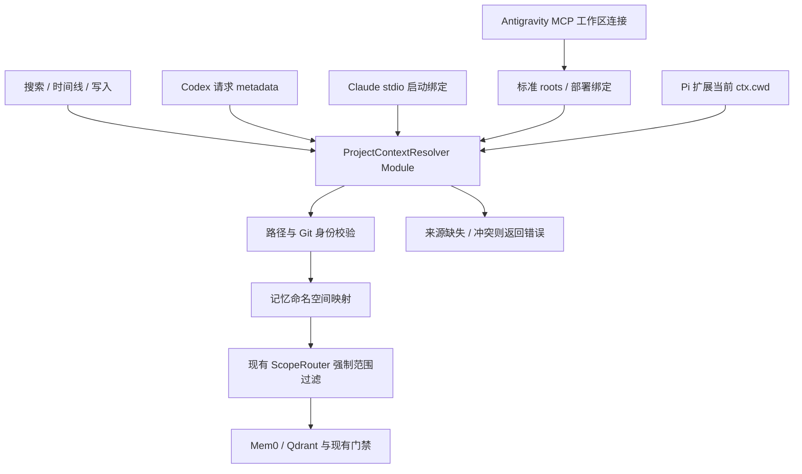

# [RFC-0003] 宿主自动项目上下文与稳定记忆命名空间

- **作者**：Codex
- **状态**：已实现；2026-10-15 完成本机四宿主召回验收并启用 canonical / v2，验收范围与剩余限制见[发布记录](/runbooks/project-context-acceptance)
- **创建日期**：2026-10-15
- **关联**：[Issue #93](https://github.com/mungerism/hippo/issues/93)、[ADR-0009](/adr/0009-request-scoped-mcp-project-routing)

## 发布结果（2026-10-15）

[PR #95](https://github.com/mungerism/hippo/pull/95) 实现本方案，[PR #98](https://github.com/mungerism/hippo/pull/98) 补齐 Antigravity stateless 协议兼容。本机部署提交为 `3bb67f3`，已启用 canonical、12 个历史命名空间绑定及 v2 Worker / Hook。软件默认仍为 legacy / v1，Codex metadata 仍需显式启用。

Codex、Claude Code、Pi、Antigravity 工作区专属插件均已完成真实调用省略项目选择器的召回验收；scope 与时间线隔离通过。本记录不代表所有宿主版本、多窗口组合及性能目标均已实测；后续章节保留设计与完整验收目标，具体证据和未覆盖范围以[发布记录](/runbooks/project-context-acceptance)为准。

## 1. 背景与目标

用户在其他项目使用 Hippo 时，应能省略 `project_id`，由宿主提供调用方上下文，Hippo 确定性地完成项目映射。缺少可靠上下文时仍应报错，不能重新引入服务工作目录兜底。

[Codex 调研](/knowledge/codex-memory-research)发现请求级 sandbox metadata 可提供执行环境 cwd；[Claude Code 调研](/knowledge/claude-code-memory-research)确认本地 stdio 的 `CLAUDE_PROJECT_DIR` 与标准 roots 可提供目录。两者都说明：模型不必重复填写宿主已经知道的信息。它们的内部文件记忆实现不必整体复制到 Hippo。

本方案覆盖 Codex、Claude Code、Antigravity 和 Pi 四个宿主，保留 Mem0、Qdrant、Hot/Warm/Cold Path 与现有检索门禁。核心改动集中在项目上下文解析与命名空间映射，不新增 Agent 工具，不增加 Agent 可调预算参数。Pi 保留原生扩展入口，Antigravity 保留 MCP 与 Stop Hook，不要求所有宿主都改为同一种传输。

### 与现有 ADR 的关系

**修订 ADR-0009 的来源限制**：允许经过明确契约约束的宿主请求元数据与本地 stdio 启动绑定；其“不使用环境变量”的绝对规则不能直接容纳 Claude Code。保留不使用服务 cwd、逐请求隔离、多候选不猜测、错误时不调用记忆后端的原则。本次实现同步在 ADR 记录受控扩展；部署默认仍沿用 legacy 命名空间。

### 验收目标

- 四个宿主在受支持、经真实连接验证的配置下，语义检索、时间线与写入均可省略 `project_id`；Antigravity 缺少可验证活动目录时使用工作区专属部署绑定，不承诺无上下文的全局连接也能自动推断项目。
- 当前项目的确定不依赖查询文本、项目显示名、最近聊天或模型猜测。
- `all` 始终等于当前项目加当前用户的 global；它不代表所有项目。
- 各自动上下文来源冲突或无效时，在后端调用前失败；不会写入错误项目后再纠正。
- 第二阶段完成后，同仓库 worktree 使用同一命名空间，同名独立仓库默认分开；历史记忆通过显式映射保留。

## 2. 范围与术语

| 概念 | 本提案中的含义 |
| --- | --- |
| 调用方上下文 | 此请求的执行目录，或专属于此 stdio 连接的稳定项目绑定 |
| 工作区 roots | 客户端声明的一组目录；可能含多个仓库，不能据顺序推断当前项目 |
| 本地仓库身份 | 本机 Git common directory 的规范化绝对路径；用于合并同仓库 worktree |
| 记忆命名空间 | 最终传入 Mem0 `agent_id` 的字符串，现有 Hippo 通常使用仓库目录名 |
| 路由来源 | explicit、codex_meta、claude_stdio、pi_context、operator_binding、roots 等诊断标签 |

目录来源与命名空间不是同一概念。当前 `detect_git_project()` 返回工作树目录名，既不能稳定合并 worktree，也不能区分分别出现在两个请求中的同名仓库。

本期不增加跨项目全文检索、全局记忆摘要文件、向量库替换或新后台抽取器。全局偏好继续显式使用 `scope='global'`；不因 `category='preference'` 就自动把项目偏好提升为全局。非 Git 目录继续支持显式命名空间，自动识别暂不扩展到非 Git。

## 3. 总体结构



MCP 保留 `resolve_mcp_scope()` 作为薄 Adapter，内部使用与 Pi 入口共用的 `ProjectContextResolver` Module。其 Interface 接收调用方上下文和显式选择器，返回解析结果；来源收集、校验、映射与错误语义集中处理。Codex、Claude Code、Pi 与 roots 是内部 Adapter，不引入通用插件框架。Pi 不需要伪造 MCP Context。

将现有 `server.py` 中的搜索/时间线分流、预算、渲染和 `add_explicit` 调用集中到可复用的 Agent memory Module，MCP 与 Pi 的本地桥接入口共用它。这样两个入口不会各自实现一套记忆语义；人类 CLI 的 `hippo add` 和表格输出可保持现有用途。

拟议内部结果为不可变数据：

```python
@dataclass(frozen=True)
class ResolvedProject:
    namespace: str
    source: str
    repository_anchor: Path | None
    worktree_root: Path | None
```

路径只用于本地处理与显式诊断，不返回到普通工具结果。解析依赖通过构造注入：连接启动绑定、受控 Git 探测、命名空间映射；根列表和请求 metadata 从当前请求获取。不得将当前项目写入 `_engine`、共享环境或可变全局字段。

## 4. 上下文来源与选择规则

### 4.1 显式选择与 global

保留旧 `agent_id` 优先覆盖语义，然后处理 global 和 `project_id`。显式命名空间表示调用方有意选择该空间，可以覆盖自动上下文；显式路径则走路径与仓库身份解析。global 不需要项目上下文。无效 scope、空白选择器不降级。

`project_id` 保留为兼容和诊断出口；正常调用说明改为“通常省略，宿主自动确定项目”。不新增 `cwd`、`host`、`thread_id` 等模型需要填写的字段。

### 4.2 自动来源

| Adapter | 输入 | 作用范围 | 首版限制 |
| --- | --- | --- | --- |
| Codex | `tools/call._meta['codex/sandbox-state-meta'].sandboxCwd` | 单次请求的执行环境 | 完成 capability 协商及真实报文验证后启用；只接受可映射到本机的路径 |
| Claude Code | 宿主注入的 `CLAUDE_PROJECT_DIR` | 一个本地 stdio 子进程 / 连接 | 启动时捕获为不可变绑定；不是共享 HTTP 服务的兜底 |
| Pi 扩展 | 工具执行回调与事件回调的 `ctx.cwd` | 当前工具调用 / 生命周期事件 | 由扩展代码传递，模型 Schema 不增加 cwd；不回退到 `process.cwd()` |
| Antigravity | MCP roots，或工作区配置创建的专属部署绑定 | 当前 MCP 连接 / 工作区 | roots 能力需探测；不能假定有 Claude 或 Codex 的专有字段 |
| 标准 MCP roots | 本次请求 `roots/list` 的结果 | 本次请求所属客户端 | 没有请求级活动线索且没有有效专属启动绑定时，必须恰好一个仓库身份 |
| 部署绑定 | 拟新增 `hippo serve --project-root /abs/repo` | 专属 stdio 连接 | 用于不传上下文的旧客户端；不按安装目录隐式生成 |

自动解析不是“逐项尝试直到某个来源成功”。来源**未提供**才允许采用其他来源；来源**已提供但无效**必须报错，防止坏路径被另一个项目掩盖。

选择规则：

1. 先解析请求级活动线索：MCP 取 Codex metadata，Pi 桥接取本次 `ctx.cwd`。同时校验所有已提供的专属启动绑定；它们必须与请求线索、彼此之间指向同一仓库，否则报冲突。
2. 形成一个**候选项目**：有请求级活动线索时使用该线索，否则使用有效的 Claude 或部署启动绑定。请求级线索和启动绑定都不存在时，候选项目为空。
3. roots 可用时逐请求读取并验证。已有候选项目时，只要求候选匹配 roots 中的一个仓库，其他有效 roots 不改变它；没有候选项目时，才要求 roots 恰好归并成一个仓库身份，并用它形成候选。候选不在 roots 中时报冲突，禁止改选第一个 root。
4. roots 未声明或确实不支持时，可单独使用候选项目；已声明却超时、返回空列表或损坏结果时不绕过失败。
5. 最终仍没有候选项目时返回 `PROJECT_CONTEXT_MISSING`；无候选且 roots 包含多个仓库时返回 `PROJECT_CONTEXT_AMBIGUOUS`。

roots 的匹配按规范化仓库身份完成，不用显示名称、路径字符串前缀或列表顺序。仅从另一 worktree 得到的上下文可以在第二阶段按 common directory 认作同仓库。

例如 Claude 在 A 启动并绑定 A，随后 `/add-dir B` 使 roots 变为 `[A, B]`，候选仍为 A，自动搜索与写入继续属于 A；部署端专属绑定同样可以消歧。若 roots 变为 `[B]`，则因 A 不在集合内而拒绝，不自动切换到 B。

### 4.3 Codex 接线

初始化必须声明 `capabilities.experimental['codex/sandbox-state-meta'] = {}`，不能误写成 MCP 的 `extensions` 字段。请求 metadata 必须来自 SDK 当前请求 Context，不能从工具 arguments 或上一次请求复制。[协商与字段证据](/knowledge/codex-memory-research#codex-专有-sandbox-state-meta-可携带-cwd)

当前安装 SDK 的 Context 提供 `request_context.meta`，低层初始化支持 `experimental_capabilities`；高层 `MCPServer` 没有同名构造参数。先验证一个局部 stdio 启动 Adapter 能通过公开初始化 Interface 注入该能力，再确定最终接线；禁止修改 SDK 全局类或把整个 server 改写为自建协议栈。若 SDK 不保留自定义 `_meta` 或真实客户端不发送字段，此 Adapter 不进入默认发布。

只解析所需的 cwd；不应用 metadata 中的权限配置，不保存整份沙箱状态。`threadId` 可用于诊断关联，不能单独推导项目。Codex 的字段语义是执行环境 cwd，不保证等于 UI 中项目标题，必须验证多环境和工作区切换行为。

### 4.4 Claude Code 接线

从原始启动环境捕获 `CLAUDE_PROJECT_DIR`，校验为本机存在的绝对目录；该值不因为添加额外 roots 而改变。官方 changelog 从 `2.1.139` 引入此机制，本机 `2.1.216` 晚于该版本，但仍需真实 stdio 测试。[官方 MCP 契约](https://code.claude.com/docs/en/mcp#option-3-add-a-local-stdio-server)

当前 `config.py` 会用 `override=True` 加载 dotenv。新增轻量启动入口必须在导入 config/engine 前捕获宿主变量，再向 server 构造传入绑定；不能等加载仓库 `.env` 后才从 `os.environ` 读取。`hippo serve` 与 `hippo-mcp` 两个入口都需覆盖，且不得在工具调用期间重新加载宿主环境。

这是宿主来源契约，不是鉴权凭据。当前实现只有 stdio；未来增加共享网络服务时，必须禁用进程级客户端绑定，使用请求上下文或由部署端明确配置的客户端路径映射。

### 4.5 Pi：原生扩展自动传递执行上下文

仓库现有 `integrations/pi/hippo-memory.ts` 注册 `search_memories`、`add_memory`，通过子进程调用人类 CLI，并不是 MCP。当前两个工具的 `execute` 没有使用上下文参数，`execFile` 也没有指定 cwd；Hook 才发送 `ctx.cwd`，且有 `process.cwd()` 兜底。因此只改 MCP 会遗漏 Pi 的前台路径。

官方扩展类型定义提供 `ExtensionToolContext.cwd`，工具执行回调接收该 Context；每次调用读取当前值，不缓存扩展首次加载目录。保留 Pi 的两个工具名和现有 `project` 显式选择器，将其在 Adapter 内规范化为 Hippo 的显式选择器；不向模型新增目录字段。[Pi 官方类型](https://github.com/earendil-works/pi/blob/main/packages/coding-agent/src/core/extensions/types.ts)、[扩展契约](https://github.com/earendil-works/pi/blob/main/packages/coding-agent/docs/extensions.md)

拟新增本地桥接 CLI `hippo agent search` / `hippo agent add`，由扩展代码自动提供 `--context-dir ctx.cwd`，子进程的 `cwd` 同样显式设置为 `ctx.cwd`，以参数数组启动而不拼接 shell。它们进入上述共用 Module，搜索使用相同时间线分流、范围过滤、预算与不可信上下文信封；写入使用 `add_explicit`，不再绕到 `hippo add` 的同步事实提取路径。stdout 只返回工具结果，诊断走 stderr；不把人类 CLI 表格直接塞给模型。

这两个命令是本地桥接 Interface，不注册为额外 Agent 工具，不开放阈值、limit 或底层写入参数。有效 global 无需 `ctx.cwd`；项目/all 调用缺少或包含非法 cwd 时失败，不改用 Pi 进程或 Hippo 安装目录。`/hippo` 人类命令也使用调用时的 ctx.cwd，并保留原有命令体验。

`agent_settled` 与 `session_shutdown` 从各自事件 Context 捕获目录快照，在发送前固定；恢复、切换会话和 reload 后都使用新的 Context。Hook 仍仅入队，缺少项目线索时记录未解析状态并停止项目写入，不能因前台兼容改动而阻塞宿主。实现时针对安装的 Pi 包版本验证回调签名，不把当前 upstream 类型无条件套用到旧版。

### 4.6 Antigravity：roots 与工作区专属连接

Antigravity 的 app/CLI/IDE 要分别探测初始化能力和连接生命周期。官方文档确认 MCP 全局及工作区配置、stdio 参数/env/cwd，但未承诺当前版本向 server 提供 roots 或活动项目 metadata；不能仅凭“支持 MCP”认定可以自动定位。Antigravity Project 还允许包含多个仓库，不直接等于 Hippo 的 Git 项目身份。[MCP 官方说明](https://antigravity.google/docs/mcp)、[Projects 官方说明](https://antigravity.google/docs/projects/)

接入顺序：支持 roots 的连接使用通用规则；不支持时，在受支持的工作区 MCP 配置中生成该工作区专属的 `hippo serve --project-root /abs/repo`。绑定路径由本地安装器/部署者写入，模型仍无需填 ID。只设置 MCP `cwd` 不等于声明项目绑定，仍不从服务 cwd 推导身份。

必须验证工作区配置是否为不同工作区创建/重建独立子进程，以及是否被同名全局 server 覆盖。无法证明专属连接时，禁用该绑定模式，保留显式项目选择；不能把一个仓库的固定 root 写入全局配置，再让所有聊天共用。切换工作区时重建绑定连接或使用新的请求级上下文，不把新目录写入旧共享 server 的全局状态。

多仓库 Project 可由经验证的请求活动目录或专属启动绑定形成一个候选仓库，再按通用规则与 roots 校验；两者都没有时需要显式选择，或部署多个名称不同、分别绑定仓库的连接供明确选择。不会默认合并前后端仓库的记忆，也不因模型调用了某个工具就把整组工作区当成一个 Git 仓库。

现有 `hippo_memory/hooks/adapters/antigravity.py` 会选 `workspacePaths[0]`，缺失时使用进程 cwd。这也需要在第一阶段修订：捕获所有 workspace 候选，Worker 验证并解析唯一仓库；多仓库且没有活动上下文时标为待解析，不蒸馏入任何项目。Stop Hook 的工作区列表仅是该事件线索，不能用于覆盖另一个 MCP 会话的当前项目。保持 Stop-only，除非新版本另有经验证的事件契约。

### 4.7 四宿主统一验收矩阵

| 宿主 | 前台上下文 | 后台捕获上下文 | 必须验证的降级 |
| --- | --- | --- | --- |
| Codex | 单请求 sandbox cwd / roots | Hook 自带目录 | 无扩展字段时使用 roots 或显式选择 |
| Claude Code | 专属 stdio 的项目根 / roots | 原生记忆不等于 Hippo Hook；本 RFC 不新增其捕获协议 | 无专属上下文时不借用其他会话 |
| Antigravity | roots / 经验证的工作区专属绑定 | Stop 的工作区候选和已验证活动线索 | 多仓库歧义、共享连接时停止自动项目写入 |
| Pi | 本次工具回调的 ctx.cwd | settled / shutdown 的事件 ctx.cwd | 缺 cwd 时拒绝项目调用，global 仍可用 |

第二阶段四个宿主对同一仓库都必须得到同一 namespace；显式覆盖、worktree、时间线和 global 的含义不随宿主变化。

## 5. 路径与仓库身份

共用一处 Git 探测：接受本机存在的绝对目录，规范化符号链接；URI 仅支持本机 `file:`，拒绝远端 authority、query、fragment、编码后的 NUL 等非法输入。不把远端 `/workspace/app` 当作服务所在机器上的同名目录；首版不自动转换 SSH、容器或其他主机路径。

所有 Git 子进程移除继承的 `GIT_*`，使用明确 cwd，并设置超时；不执行 remote 网络命令，不读取任意仓库脚本，不修改 `os.environ`。保留现有 roots 2 秒超时，并为整个自动解析设置 2.5 秒 deadline；取消和超时不进入后端。

第二阶段通过本地 Git 查询获得工作树根和绝对 common directory，以 common directory 的真实路径作为本地仓库身份：

- 主工作树与 linked worktree 归到同一身份；子目录同样归并。
- 不同 clone 默认是不同身份，即使 remote URL 相同；submodule 是独立仓库。
- 单独的 bare 仓库不作为默认活动工作树；其 linked worktree 仅在探测契约覆盖后支持。
- 移动目录、重建仓库、跨机器路径变化通过显式绑定处理，不自动按同名或 remote URL 合并。

不把 `git_root.name`、common directory 路径或 thread ID 直接当作通用、跨机器稳定项目 ID。

## 6. 命名空间兼容：分两次发布

### 第一阶段：补齐自动来源，沿用现有命名空间

补齐 MCP 上下文来源及 server 启动接线，同时让 Pi 前台桥接与 Antigravity Hook 停止猜测目录；这些入口复用同一解析与 Agent memory Module。自动路由仍输出现有仓库名，旧记忆可见性和显式项目名保持兼容；不重命名 Qdrant 数据，也不同时更换后台命名空间格式。Hook 可增加版本化上下文候选字段，以便明确表示缺失或歧义。

**此阶段不宣称解决同名仓库与 worktree 命名空间问题。** 含多个不同 worktree 根的 roots 仍按原 ADR 拒绝；实际使用 worktree 时可显式传已有命名空间。项目过滤依赖已选中的命名空间正确，不意味着同名目录天然隔离。

这一步可以独立验证四个宿主的免手填体验；第二阶段通过前，不将“任意仓库均可正确归并与隔离”作为发布承诺。

### 第二阶段：部署端仓库绑定与无冲突默认 ID

使用用户管理的 `~/.hippo/projects.json` 保存版本化映射，文件属于部署配置，不放入任意仓库的 `.env`。拟议格式：

```json
{
  "version": 1,
  "mode": "canonical",
  "bindings": [
    {"repository_anchor": "/repos/hippo/.git", "namespace": "hippo"}
  ]
}
```

绑定后的仓库继续使用旧命名空间，兼容历史记忆；同仓库所有 worktree 查询同一映射。新模式下，未绑定仓库的默认命名空间为 `repo_` 加规范化 anchor 的完整 SHA-256，而不是目录名。不截断哈希、不自动按 remote 合并；显示名称与存储键分离。

多个 anchor 指向同一 namespace 必须是运维者明确配置的共享关系。映射冲突、未知版本、配置损坏直接报错。文件写入通过现有锁工具、临时文件及原子替换实现，不能用热路径读写的“最近项目缓存”代替。

拟新增部署 CLI：`hippo project inspect /abs/repo` 输出解析来源、身份与新旧命名空间；`hippo project bind /abs/repo --namespace hippo` 显式保留旧空间。它们不注册为 Agent MCP 工具。

升级先生成只读映射预览，明确列出未绑定项目，然后再启用 canonical 路由模式。**不自动读取旧名和新 ID 的并集**，不把旧 basename 命中当作正确归属的证据；来源不足的历史同名记忆不能自动拆分。尚未绑定的旧记忆可用原显式 ID 访问，新模式不会猜测归属或复制数据。

该阶段必须同时接入 MCP、CLI/SDK、Warm Path Worker 和治理命令，使同一上下文始终映射到同一 namespace。Hook 的 `<50ms` 捕获路径继续只保存宿主目录与原始元数据；Worker 必须在任何作业合并或蒸馏之前解析并持久化最终身份，重试沿用该身份。已经进入处理的旧作业保留原 ID，不重新计算历史游标。

为避免把 Hook 自动推导出的旧 `project_id` 误认作人工绑定，新增作业版本需区分显式选择器、宿主目录和已经固定的最终 namespace；三者不得复用一个字段。旧版本作业走旧身份规则，新版本只在首次解析成功后固定 namespace。项目映射按请求/作业读取一致快照，不在一次处理中跨版本拼接。

### 6.1 身份解析先于队列合并

现有 `SpoolWorker.drain()` 在 `process_one_job()` 之前调用 `coalesce_pending_jobs()`，而合并目前仅按 `session_id` 分组。新增来源和作业格式的第一阶段就必须调整顺序，不能等第二阶段更换 namespace 时才修复：

1. 读取作业 envelope，验证格式版本；无版本字段的作业按明确的 legacy 契约读取，未知版本拒绝消费。
2. 使用该作业捕获的上下文和一次映射快照，解析并持久化不可变的路由结果：用户身份、namespace、来源仓库、路由模式与映射修订；此步骤不调用记忆后端或 LLM。已有路由结果只验证其完整性，不重新绑定。
3. 仅把格式兼容且 `(host, user_id, session_id, namespace, routing_mode, mapping_revision, capture_segment)` 完全相同的作业放入同一合并组，再验证新快照包含旧快照。相同 session ID 或文本包含关系都不足以授权合并。
4. 缺少上下文、冲突或版本不支持的作业隔离为待处理/不可消费记录，不得取代任何已解析作业；其重试必须经显式修复，不循环猜测项目。
5. 合并和蒸馏只使用已持久化身份；旧作业保留旧路由模式，不能与 canonical 作业相互合并。目录、绑定或服务默认配置的后续变化不得改写已固定身份。

上下文变化还涉及**内容范围**：即使禁止 A/B 作业合并，B 的全会话快照仍可能含 A 的历史。宿主 Adapter 必须用可信的转录偏移、事件序号或会话切换标记划分 `capture_segment`，每段仅包含其上下文下的消息。跨项目切换或路由模式切换时，不能把旧前缀重新归到新身份；无法证明片段范围时隔离该混合片段，要求新的独立会话/可验证捕获段后再恢复自动蒸馏，不交给 LLM 猜测归属。

这些字段随版本化作业持久化，不增加 Agent 工具参数。第一阶段使用 legacy namespace 也执行上述身份预解析与合并限制；第二阶段只替换身份计算与映射规则。

### 6.2 生产者、消费者与版本切换

只在 payload 增加版本字段不足以隔离旧 Worker：现有 `CapturedPayload.from_dict()` 会丢弃未知字段，而旧 Worker 仍按旧字段计算项目。因此新格式作业必须进入独立物理队列：拟使用 `~/.hippo/spool/v2/`，保持旧作业在原根的 `jobs/` 下。旧消费者只能看到旧队列；不能把 v2 envelope 放进原 `jobs/` 后期待旧程序主动拒绝。

兼容消费者显式识别 v1/v2 envelope，并在构造 `CapturedPayload` 之前检查版本；缺失版本只允许存在于 legacy 队列，v2 队列必须显式标明受支持版本。未知版本、字段不完整或路由结果损坏时隔离，不按 v1 再试。新消费者可排空 legacy 队列，但保留原身份、游标和终态语义；两个队列不得相互合并。消费者锁与恢复操作按队列版本管理。

新格式发布顺序从第一阶段开始适用：

1. 暂停受管理的捕获入口、自动 drain 和项目写入，保留已发布作业；此维护窗口在部署前明确安排，不把“Hook exit 0”当作已保存新事件的证明。
2. 停止旧 daemon/drain 消费者，禁用其自动重启，确认进程退出和对应 worker 锁释放。锁被旧版本持有不能当作新消费者健康信号。
3. 先安装并启动能够识别目标格式的兼容消费者，核验运行中的版本、支持格式和队列位置；再升级四宿主捕获入口及其自动 drain 启动命令，确认它们只向新队列发布。
4. 验证没有受管理的旧生产者/消费者后，才解除维护暂停、允许发布新格式。若任何一项失败，保持生产者暂停或原版本整体运行，不能让新生产者向旧队列降级发布。

第二阶段打开 canonical 模式前再次执行切换屏障：暂停项目写入与捕获，处理完或显式隔离所有仍可能写入旧身份的 legacy 作业，生成/核验历史绑定，然后统一切换前台与兼容 Worker 的路由模式，再恢复。不能让未完成的 basename 作业和新 ID 写入在无绑定的同一项目上交错运行。

回滚时先暂停捕获、自动 drain 和后台消费，保存两个队列、映射与固定身份。需要保留 v2 兼容消费者继续处理，或将整个 v2 队列保持不可消费；旧消费者恢复后仅能访问 legacy 队列，绝不能搬入或重新解释 v2 作业。canonical 启用后的前台操作只能按已保存 namespace 显式访问或使用兼容解析；若旧版本做不到，保持项目写入暂停，不退回 basename。恢复处理须先重新验证消费者能力，不重算已固定身份。

legacy 队列也不能无条件交回旧消费者：兼容消费者曾为旧作业固定的身份可能存在旧程序不认识的字段。恢复旧消费者前，兼容消费者须排空原有 legacy 作业，或将它们整体隔离到旧消费者不可见的位置；不能因为 envelope 是 v1 就重新按当前目录解释其身份。隔离不意味着丢弃，恢复时仍由兼容消费者按保存结果处理。

## 7. 记忆行为保持一致

| 操作 | 行为 |
| --- | --- |
| `search_memories(query)` | 自动解析项目，搜索该项目 + 当前用户 global |
| `scope='project'` | 仅选定命名空间 |
| `scope='global'` | 仅当前用户 global，无需项目 |
| `add_memory(text)` | 自动解析项目并写入该项目；global 必须明确指定 |
| 显式 `project_id` | 保留选择其他命名空间或诊断的出口 |

搜索、时间线和写入共享解析结果，再进入现有 `ScopeRouter`、过滤组合、活跃性检查、相关性门禁与不可信上下文渲染。`session_id` 只作来源信息，不变成长期事实的硬检索条件。任何跨项目复用都通过 global 或明确项目选择表达。

本方案不新增每会话自动注入全局索引：现有 MCP 按需检索已经提供受预算控制的召回；是否增加会话摘要，应在检索评测显示必要后单独设计。项目路由错误不能靠提示模型忽略无关摘要来弥补。

## 8. 错误、可观测性与性能

内部错误码至少包括 `PROJECT_CONTEXT_MISSING`、`PROJECT_CONTEXT_INVALID`、`PROJECT_CONTEXT_CONFLICT`、`PROJECT_CONTEXT_AMBIGUOUS`、`PROJECT_CONTEXT_TIMEOUT` 与 `PROJECT_BINDING_INVALID`。普通 MCP 输出继续使用现有错误形态，给出“重连宿主 / 检查部署绑定 / 显式 project_id”的可操作提示，不返回客户端异常正文或原始路径。

默认日志记录来源、错误码、耗时和成功/失败计数，不记录完整 metadata、记忆内容或目录。路径详单仅由本机 `project inspect` 显式展示。来源字段不开放给模型选择。

自动解析不调用 LLM、embedding 或网络。健康本地环境的解析 p95 目标为 50ms，以实测为准；不能把它算作不增加延迟。显式选择器和有效 global 不请求 roots。第一阶段不缓存活动项目，避免会话切换串用。

## 9. 实施顺序与验证

| 步骤 | 交付 | 完成条件 |
| --- | --- | --- |
| P0 协议验证 | 隔离的本地 MCP 探针、脱敏最小报文 fixture | 确认 Codex 协商/字段、Claude 环境、Pi 回调上下文、Antigravity roots/工作区连接与 Stop payload；不写生产记忆 |
| P1 Module 与 roots | 统一解析结果、超时、候选项目与 roots 校验规则 | 三个记忆入口走同一 Interface；专属绑定可消歧多 roots；现有 #93 回归继续通过 |
| P2 Claude Adapter | 两个启动入口的原始环境捕获 | 真实 stdio 省略 ID；dotenv 无法覆盖宿主绑定 |
| P3 Codex Adapter | 局部初始化能力与请求 metadata 读取 | 当前桌面与 CLI 分别验证；多环境语义满足契约才默认开启 |
| P3a Pi Adapter | 扩展逐调用 ctx.cwd、本地安全桥接、事件目录快照 | 省略项目参数时，搜索/写入/时间线与 Hook 归属一致；与安装目录解耦 |
| P3b Antigravity Adapter | roots 探测、工作区专属绑定、移除 Hook 首 root 猜测 | 单仓库免手填，多仓库歧义零写入，多窗口连接不串用 |
| P3c 队列兼容 | v2 独立队列、版本校验、合并前固定身份、捕获分段 | 跨项目/模式/版本不得相互合并；旧消费者读不到新作业；兼容消费者可按原契约处理旧作业 |
| P4 第一阶段发布 | 描述、部署文档、ADR 修订、切换屏障与回滚演练 | 四宿主两仓库交替调用不落到安装仓库；先升级消费者再发布新格式；旧 Worker 存活时阻止切换 |
| P5 身份映射发布 | common-directory 身份、绑定 CLI、全部入口统一 | worktree 共用、同名仓库分开；先处理/隔离旧身份作业再切 canonical；在途作业及回滚验证 |

Interface 层测试覆盖：global/显式覆盖；单 roots；多 roots + 请求活动线索；多 roots + 专属启动绑定；无两者时多 roots 歧义；缺失/空/损坏/超时；metadata 与 env/roots 冲突；非本机 URI；路径不存在；`GIT_DIR`/`GIT_WORK_TREE` 污染；两客户端并发与连续 A→B→A 请求。所有失败都断言后端零调用，写入亦然。

明确覆盖 Claude 在 A 启动后 `/add-dir B`：绑定 A、roots `[A,B]` 应成功路由 A；部署绑定 A 同样成功；roots 只有 B 时应报冲突。不得把“roots 不唯一”和“无法确定候选”混为一谈。

Pi 额外验证：子进程安装位置与 ctx.cwd 不同、两个并发上下文、resume/reload 后目录变化、缺失 ctx、global、错误退出码和同一门禁/信封/2000 字符限制。Antigravity 额外验证：IDE/app/CLI 版本能力、多窗口与工作区切换、全局/工作区同名配置覆盖、多 roots、多 worktree、Stop payload 无 workspace 和多仓库列表；未解析作业不触发后端写入且 Hook 正常退出。

第二阶段额外覆盖：两个同名仓库、linked worktree、submodule、符号链接、目录移动后的显式重绑定、旧命名空间、映射更新期间的作业重试，以及语义检索/时间线/Cold Path 的身份一致性。真实测试使用临时仓库和测试用户，验证数据可见性而不仅是解析字符串。

从第一阶段即执行队列回归：同 host/session 的 A→B 快照互为包含时不能跨项目合并；相同 namespace 但不同路由模式、映射修订或捕获段不能相互替代；未解析作业不能吞并已解析作业；混合历史无可信分段时零蒸馏。另测旧 Worker 存活/持锁时切换失败、未知 envelope 版本被隔离、新格式不会出现在旧队列，以及新队列未清空时回滚不重解释身份。第二阶段增加 legacy 与 canonical 同会话的交错投递及屏障期间写入暂停测试。

## 10. 备选方案、回滚与待核实项

| 方案 | 取舍 |
| --- | --- |
| 始终要求模型传 ID | 最兼容，但重复宿主信息，无法实现正常路径免手填 |
| 只使用 roots | 标准且已实现，但当前 Codex 缺 roots，多仓库时缺活动项目线索 |
| 服务 cwd / 最近 rollout 猜测 | 无法证明属于当前调用，会重现 #93，拒绝 |
| 只注入全局摘要让模型筛选 | 可跨任务复用，但不解决确定性项目路由，拒绝作为隔离方案 |
| 按 Git remote URL 自动合并 | 跨 clone 方便，但 fork、多 remote 和信任关系不清，首版不采用 |
| 一次同时迁移所有记忆 ID | 能统一命名，但历史归属证据不足；选择先来源、再显式映射 |

第一阶段的来源 Adapter 可分别关闭，前台恢复 roots/显式 ID 路径；这不意味着能跳过队列版本回滚。只要发布过新格式，消费者升级、回滚与消费恢复均遵循第 6.2 节，旧程序不得处理 v2 队列。第二阶段还须保留映射与固定 namespace，禁止退回 basename 继续写；无法保持身份契约时暂停项目写入。数据批量搬迁不包含在此次路由发布中。

待 P0 核实：Codex 实际传输的 `PathUri` 表示和多环境 cwd、现有 MCP SDK 公开初始化方式、Claude 会话切换项目时是否重建 stdio 连接、安装的 Pi 回调签名、Antigravity 各 surface 的 roots 与工作区专属 server 生命周期及 Hook 字段。缺少证据时保留显式选择，不推断成功。

待评审的主要产品取舍是第二阶段的身份规则：本提案推荐“默认独立 clone 分开，显式绑定才共享”，以及“历史项目先绑定再切 canonical 模式”。这两项影响历史可见性，须在实施前定案。

## 11. 实现与验收边界（2026-10-15）

共享解析器、stdio 启动绑定、可选 Codex metadata 协商、Pi 安全桥、项目绑定 CLI、v2 独立队列、固定身份和会话隔离已实现。默认仍为 legacy 命名空间、v1 捕获；Codex 扩展需要显式 `--codex-context`。部署步骤见[自动项目路由运维](/runbooks/project-context)。

当前未实现可信转录偏移分段：上下文缺失、歧义、冲突或实际项目/路由模式切换会持久化阻断该会话后续自动蒸馏，必须开启新的独立会话。无关绑定造成的映射 revision 变化只阻止合并，不阻断身份未变的会话。已固定作业重试继续使用原身份。

隔离测试覆盖临时 Git 仓库与 worktree、MCP initialize/call_tool 线协议、模拟后端零调用、队列切换与恢复。Pi 0.83.0 的实际扩展加载器已验证工具回调与 `ctx.cwd` 桥接。上述验证不等同于四宿主真实聊天的端到端验收；第 9 节 P0 仍是启用实验来源与 canonical 的发布条件。
